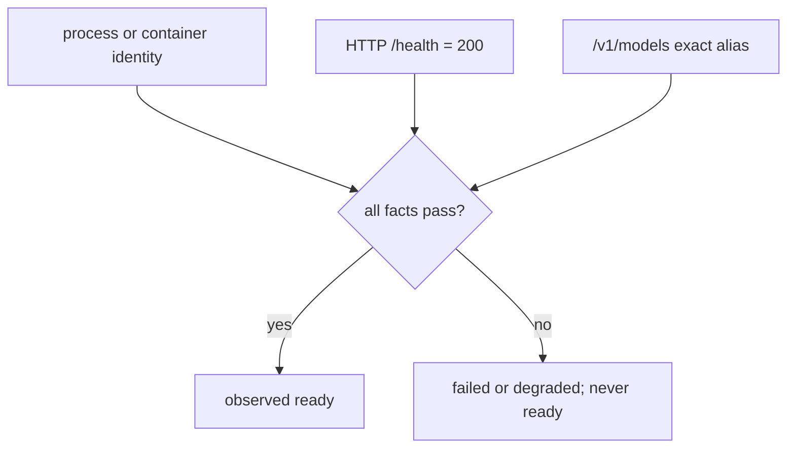

# Architecture

The controller is a local, loopback-only Python service (standard library only)
with a zero-build browser UI. It reaches DGX Spark nodes over SSH, keeps a
durable operation journal in SQLite, and is the single owner of model
lifecycles on the nodes it manages.

## Module map

```text
controller.launcher           desktop launcher: native window or browser; owns only its local child
controller.main               CLI: parses options, builds ServiceHost and the HTTP server
controller.server             loopback HTTP routes and static UI files
controller.host               ServiceHost: setup mode, hot reload, long-lived services
├─ controller.app             ControllerApplication: lifecycle requests and one lifecycle worker
│  ├─ controller.resources    browser-safe resource shapes and text redaction
│  ├─ controller.projection   profile + node IDs -> DeploymentSpec
│  ├─ controller.orchestrator load, unload, recover; leases, readiness, rollback
│  ├─ controller.reconcile    restart and on-demand reconciliation from fresh observations
│  ├─ controller.telemetry    shared, rate-limited capacity sample cache
│  └─ controller.transport    NodeTransport protocol
│     ├─ fake                 deterministic in-memory nodes
│     └─ managed_ssh          observations and lifecycle over SSH
│        ├─ managed_config    validated node and cluster-recipe settings
│        ├─ observation       unit and cluster probes and their parsers
│        ├─ vllm_identity     exact argv and environment identity of a container
│        ├─ preflight_checks  read-only launch gates
│        ├─ cluster_scripts   pinned cluster start, stop, overlay and marker scripts
│        ├─ script_output     parsing of KEY=VALUE script output
│        ├─ ssh               bounded `ssh ... bash -s` execution of fixed scripts
│        └─ runners.systemd_user  named `systemd --user` units for single-node profiles
├─ controller.discovery       onboarding wizard backend
│  ├─ network, scanner, mdns  private-subnet scan and candidate ranking
│  ├─ hostkeys                ssh-keyscan, fingerprints, controller known_hosts, ~/.ssh read-only lookup
│  ├─ sshkeys                 key discovery and generation (never reads private keys)
│  ├─ identify                read-only identity probe and link check
│  ├─ commands                bounded argv-only local command runner
│  └─ setup                   SetupService: wizard state; writes nodes.json
├─ controller.recipes         recipe builder
│  ├─ spec, store             validated drafts, one JSON file per draft
│  ├─ generated               generated profile files in the data directory
│  ├─ catalog_client          cached access to controller.catalog
│  ├─ render                  remote environment files and the generated profile
│  ├─ nodeops                 fixed prepare and removal scripts over SSH (and a fake)
│  ├─ service                 RecipeService: drafts and the worker for both runs
│  ├─ prepare, delete         the journaled prepare and delete-recipe runs
│  ├─ journaling              shared operation outcomes and prepare history
│  └─ templates/vllm-release  pinned prepare.sh, start.sh, stop.sh
└─ controller.updates         scheduled system updates of the nodes
   ├─ settings                schedule and download source in update-settings.json
   ├─ service                 UpdateService: Updates page, helper install, scheduler thread
   ├─ engine                  ClusterUpdateEngine: the journaled update run on the lifecycle worker
   ├─ nodeops                 helper calls, node facts and reverse tunnels over SSH (and a fake)
   ├─ relay                   loopback update relay: Internet with a cache, or a local directory
   └─ templates               root helper dgx-spark-controller-update.sh
controller.catalog            allowlisted HTTPS JSON: huggingface, vllm_releases, http
controller.config, domain     strict JSON parsing into immutable records
controller.operations, persistence  operation records and the SQLite journal
controller.paths              per-OS config, data and log directories; private file writes
controller.webui              static HTML, CSS and ES modules
```

## Dependency direction

```text
server -> host -> app -> projection / orchestrator / reconcile -> persistence + NodeTransport
          host -> discovery.setup -> discovery.{network, scanner, hostkeys, sshkeys, identify}
                                     discovery.identify -> transport.{ssh, script_output}
          recipes.{render, nodeops}, updates.{engine, nodeops} -> transport
          host -> recipes.service -> recipes.{prepare, delete, render, nodeops, store} + catalog_client -> catalog
          host -> updates.service -> updates.{settings, nodeops, relay} + app
                  app -> updates.engine -> orchestrator + updates.{nodeops, relay}
config JSON -> config -> domain records -> projection -> DeploymentSpec
```

- `domain` is side-effect free. `config` reads local JSON and never connects to
  a node. `paths` resolves directories (and creates them on request) and
  writes private files atomically.
- Transports, runners, discovery and recipe node operations never import the
  server or the UI. The browser reaches remote work only through journaled
  operations, fixed read-only wizard probes, and the Updates page's check and
  one-time helper install, which run fixed helper commands without a journal
  entry.
- `catalog.http` is the only module that opens outbound HTTPS connections for
  the controller itself. `updates.relay` is the second module that reaches
  upstream hosts, on behalf of the nodes: only in online mode, and only hosts
  the nodes' apt sources name plus LVFS, over HTTP, HTTPS or a `CONNECT`
  tunnel.
- Persistence stores records and events; it never decides whether a process is
  safe to stop.

## Ownership boundaries

| Concern | Owner | Must not |
| --- | --- | --- |
| JSON syntax, defaults, unknown-key rejection | `controller.config` | connect to nodes or run commands |
| configuration vocabulary and immutable contracts | `controller.domain` | perform I/O or infer observed state |
| process lifetime, setup mode, reloads | `controller.host` | rebuild while a lifecycle operation is active |
| lifecycle mutation | `controller.orchestrator` | accept commands, paths or flags |
| desired/observed reconciliation | `controller.reconcile` | resolve an operation that is still running in this process |
| SSH execution | `controller.transport` | expose raw SSH details to the API or UI |
| single-node process start/stop | `controller.runners` | broad `pkill`, port-only identity, unpinned scripts |
| node onboarding | `controller.discovery` | authenticate during a scan, accept passwords, read private keys |
| model and release metadata | `controller.catalog` | contact hosts outside the allowlist or download weights |
| recipe drafts and prepare | `controller.recipes` | start, stop or adopt a model process |
| node system updates | `controller.updates` | run root commands other than the helper's subcommands, keep the sudo password, or relay hosts outside the nodes' sources and LVFS |
| operation history | `controller.persistence` | store secrets or rewrite events |
| local window | `controller.launcher` | call any lifecycle route |
| inference | OpenAI-compatible clients | start, stop or restart model servers |

## Service host and setup mode

`ServiceHost` owns the journal, the setup wizard, the recipe builder, and the
update service and relay for the whole process. It builds a `ControllerApplication` only when `nodes.json`
exists and parses:

- **Setup mode.** Without a valid `nodes.json` there is no application. Setup,
  catalog and recipe routes work; lifecycle routes answer `409
  setup_required`; `GET /api/v1/bootstrap` returns empty collections and a
  `setup` object. An invalid file is reported as `setup.config_error` instead
  of stopping the service.
- **Hot reload.** Saving nodes in the wizard, or a prepare registering a
  generated profile, requests a rebuild. The host rebuilds only while no load,
  unload, recover, reconcile or update operation is queued or running; until then
  `setup.reload_pending` is true. A rebuild reloads `nodes.json` and every
  profile directory, does not run startup reconciliation again, and refreshes
  node observations in the background. The journal, wizard state and the
  prepare worker survive rebuilds.

Profiles are loaded from the hand-reviewed directory (`<config>/profiles`) and
the generated directory (`<data>/profiles`); see
[Configuration](CONFIGURATION.md#file-locations).

## Desired and observed state

Desired state is the profile and placement an operator requested. Observed
state is measured on the node and endpoint. A deployment is `ready` only when
all readiness facts agree:



When a profile enables `readiness.completion_canary`, a load additionally
requires one bounded chat completion to succeed before it commits `ready`; see
[Operations](OPERATIONS.md#completion-canary).

A matching managed process may be adopted as observed state after a restart. A
process that does not match is `unmanaged` and is never stopped automatically.

## Deployment record states

A deployment record stores the desired state (`ready` or `stopped`) and the
last observed state the controller proved: `starting`, `ready`, `stopped`,
`failed` or `unknown`; the
[state catalog](STATE_AND_ERROR_CATALOG.md#deployment-states) lists when each
is written. There is no deployment transition table: the orchestrator records
what its checks proved, and the operation phase carries the detailed progress,
with legal edges enforced by `controller.operations.LEGAL_PHASE_TRANSITIONS`.

## Deployment modes

| Mode | Backend | Placement | Launch |
| --- | --- | --- | --- |
| `independent` | llama.cpp | one node | an allowlisted, hash-pinned script in a named unit `dgx-model-<id>.service` |
| `shared-vllm`, `head-script` | vLLM | two or more nodes | one hand-reviewed launcher on the control node starts every rank |
| `shared-vllm`, `per-node` | vLLM | one or more nodes | the controller starts the same pinned script on each node |

`shared-llama-rpc` is reserved in the vocabulary but not implemented.

Shared modes are one transaction: the orchestrator holds a cluster lease plus
per-node leases, preflights every node before stopping anything, starts worker
roles before the head, stops the head before workers, and records the
previous placement so a failed load can be rolled back on every node. A
deployment never runs on part of its placement: a load that replaces one
extends its leases to the replaced deployment's nodes outside the requested
placement and stops, verifies and, on rollback, restores it on all of them
(see [Operations](OPERATIONS.md#switching-across-placements)).

### Per-node launch contract

Generated recipes always use `launch_mode: per-node`. The profile carries a
profile-wide `required_environment` and one `node_environment` overlay per
allowlisted node (`NODE_RANK`, `VLLM_HOST_IP`, `MODEL_ROOT`). For each
assignment, workers first, the transport:

1. Renders a mode-`0600` overlay `.env.dgx-controller-<profile-id>` in the
   recipe's working directory on that node from the installed `recipe.env`
   plus that node's values.
2. Writes the node's ownership marker
   (`$XDG_STATE_HOME/dgx-controller/<deployment-id>.owner`).
3. Verifies `start.sh` with `bash -n` and its pinned SHA-256, and checks every
   expected `KEY=value` line of the overlay.
4. Starts `start.sh` with `ENV_FILE` set, in the unit
   `dgx-cluster-<deployment-id>.service`.

Each node reports its own launcher outcome, so a failed rank fails the load
promptly. Unload and recovery run the pinned, hash-checked `stop.sh` on each
node, head first; it removes only the container whose ownership label matches
the deployment. Nodes never need SSH access to one another.

The `head-script` mode runs one reviewed launcher on the control node, which
starts the worker before the head. It requires at least two nodes. The example
profile in `config/examples/profiles/` uses it.

## Prepare runs beside the lifecycle

A recipe `prepare` is a journaled operation (`action: prepare`, phases
`validating` → `preparing` → `committing` → `complete`) executed by the recipe
service's own single worker, not by the lifecycle worker:

- It takes no cluster or node lease and never starts, stops or adopts a model
  process. A long download therefore never blocks loading or unloading the
  current model.
- Its node-side work runs in transient `dgx-prepare-<id>.service` units and
  writes only to the recipe directory, the model root and the Docker image
  store. It requires lingering for the node user, so the units outlive the
  controller's SSH sessions, and it removes only its own recipe directory
  after a failure or cancellation.
- Recipe operations (`prepare`, `delete-recipe`) are never resolved by the
  reconciler or by the startup cleanup of queued lifecycle work. Closing the
  controller leaves a running prepare's units alone. On the next start,
  `RecipeService.recover_interrupted` cancels queued recipe operations,
  reattaches to a running prepare on the recipe worker (it finishes normally
  when every node's unit still runs or already succeeded), and ends it
  `needs-attention` only when a node's state cannot be read.
- `delete-recipe` runs on the same worker. It is refused while a profile is in
  use, holds node leases (not the cluster lease) while it removes files, and
  removes node directories before profile files, so it never races a load of
  the profile it deletes.

The generated profile becomes loadable only after the host reloads, and
loading it goes through the ordinary orchestrated lifecycle.

## Concurrency and restart

The journal has one cluster lock plus per-node leases, renewed by a lease
keeper during long SSH work. An operation may extend its leases once it knows
the full set of nodes it will stop; the extension is all-or-nothing and
refuses before any mutation if another operation holds one of them. A
cluster update holds the cluster lease and every node lease from its first
check until the deployments it stopped are restored. A request with a known idempotency key returns
the existing operation; the same key for a different action is a conflict.
On restart, running lifecycle operations are resolved by reconciliation:
proven outcomes succeed, everything else becomes `needs-attention`. Queued
lifecycle operations are cancelled.

Closing the UI, the launcher, or the service never unloads a remote model.

## Telemetry

`controller.telemetry.TelemetryCache` shares read-only capacity samples across
browser tabs and serializes collection. Each node is sampled at most once per
ten seconds; failures are cached too. The SSH probe reads `/proc/meminfo` and
one `nvidia-smi` utilization value and never touches readiness. See the
[API contract](API.md#live-capacity-monitoring).

## Node identity versus host name

The controller ID (for example `spark-a`) is stable configuration identity and
appears in profile allowlists. The host name a node reports is an observed
fact. The wizard suggests an ID derived from the host name, but the two are
never required to match.
