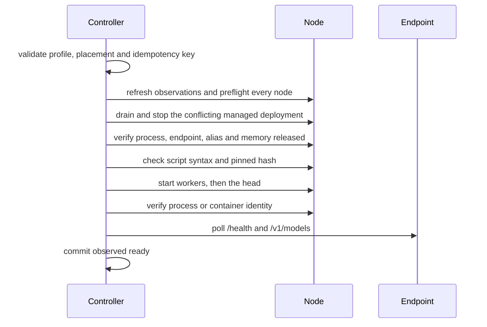

# Operations and safety algorithms

Every lifecycle mutation is a durable operation with an idempotency key,
cluster and node leases, append-only events, a phase, progress, the previous
placement, redacted evidence and a final state. The browser and API cannot
mutate a node directly; they can only enqueue operations. Operation states and
codes are listed in the [state and error catalog](STATE_AND_ERROR_CATALOG.md).

| Action | Worker | Changes a model? |
| --- | --- | --- |
| `load` | lifecycle | yes: may stop the conflicting deployment, then starts the profile |
| `unload` | lifecycle | yes: stops one proven deployment |
| `recover` | lifecycle | yes: stops an exactly identified shared placement |
| `reconcile` | lifecycle | no |
| `prepare` | recipe | no: downloads images and weights only |

The lifecycle worker runs one operation at a time. `prepare` runs on the
recipe service's own worker, so it can proceed while a load or unload runs.

## Load or switch

1. Validate the request; a duplicate idempotency key returns the existing
   operation.
2. Acquire the cluster lease and the node leases. Refresh observations; never
   plan from a stale UI snapshot.
3. Preflight every selected node: SSH reachability, the `systemd --user`
   manager, model files and manifest hash, the recipe revision and pinned
   image (shared vLLM), script readability, `bash -n` and the pinned SHA-256,
   and the observed endpoint and memory state.
4. Record the previous placement and mark a conflicting managed deployment
   draining.
5. Stop the conflicting deployment through its own named unit or pinned stop
   script, head before workers. Never use a broad process match.
6. Verify the old process or container is gone, the endpoint is closed, the
   alias is absent, and free memory and swap satisfy both profiles before
   starting anything.
7. Start worker roles, then the head, using only the pinned script. The
   profile's argv fragments are checks, not a replacement command.
8. Poll until process identity, `/health == 200` and the exact alias all pass,
   within the profile's startup timeout. A dead rank fails the load at once.
9. Persist `ready` and release the leases.
10. On failure, stop every partially started unit. Restore the previous
    placement only if preflight proves it is still valid; otherwise end in
    `needs-attention`.

If preflight observation proves the requested placement is already ready, the
operation commits without any remote mutation.

A lease keeper renews the leases while long SSH work runs, so a slow startup
cannot silently lose exclusivity.

### Shared vLLM launches

- **Per-node** (generated recipes): on each node, workers first, the controller
  renders that node's mode-`0600` environment overlay, writes its ownership
  marker, checks the pinned `start.sh`, and starts it in the unit
  `dgx-cluster-<deployment-id>.service`. Each node reports its own launcher
  outcome. See [Architecture](ARCHITECTURE.md#per-node-launch-contract).
- **Head-script** (hand-reviewed profiles): the controller renders the overlay
  and writes ownership markers on every node, then runs the reviewed launcher
  on the control node, which starts the worker before the head.

Ownership markers live in `${XDG_STATE_HOME:-$HOME/.local/state}/dgx-controller`
(directory `0700`, files `0600`) so they outlive SSH sessions. Stop removes
them; reconciliation never creates them.

## Unload

1. Refresh state and confirm the deployment still owns its unit, containers and
   endpoint.
2. Acquire leases and mark the deployment draining.
3. Stop the head (or single unit) and then the workers through their own
   identity, escalating only after a timeout.
4. Verify process exit, endpoint closure, alias disappearance, memory recovery
   and the swap bound. Model files are never touched.
5. Persist `stopped`, append evidence and release the leases.

A process, healthy endpoint or alias that cannot be tied to the deployment
blocks unload with `unmanaged_deployment`. `already_stopped` is returned only
after the same release checks pass on every node; missing ownership alone
never satisfies it.

## Prepare

A recipe prepare downloads everything a generated profile needs, without
touching any model process. Details are in [Recipes](RECIPES.md#3-prepare).

1. Validate the draft against the current nodes: port inside every node's
   range, same first model root, same home directory.
2. Install `prepare.sh`, its data file and the expected weight list in the
   recipe directory on every node, verifying each file's SHA-256.
3. Start `prepare.sh` in `dgx-prepare-<id>.service` on every node.
4. Poll every node, journal progress, and fail fast when a node reports
   `failed` or stops reporting.
5. Require all nodes to report the same image ID, vLLM version and weight
   manifest hash.
6. Install `start.sh`, `stop.sh` and `recipe.env` on every node, write the
   generated profile, and mark the draft `prepared`.

Prepare takes no lease. On failure or cancellation the controller stops the
prepare units and download containers it started; downloaded files remain and
are reused by the next prepare.

## Reconciliation

On startup, and when requested, reconciliation queries every configured node
and compares process or container identity, endpoint health, alias and profile
revision with the journal:

- A matching managed deployment is adopted as observed state.
- A process that does not match is reported as `unmanaged` and never stopped.
- A known managed replacement proves an older placement stopped, even if its
  historical desired state still says ready.
- Lifecycle operations left `running` by a restart succeed only if their
  outcome is proven; otherwise they end `needs-attention` with
  `operation_interrupted`. Queued lifecycle operations are cancelled.
- Prepare operations that are still alive in this process are skipped.

Node actions in the UI use only the freshly observed deployment ID; they never
select a historical deployment because it used the same node.

## Cancellation and rollback

A lifecycle operation can be cancelled only while it is still `queued`. Once
remote work has started, the operation runs to a verified end, including
bounded cleanup. A running prepare can be cancelled at any time. Rollback is
best effort but bounded: a failed restoration is explicit and never hidden
behind a successful result.

## Recover baseline

Recovery is a deliberate mutation for a shared vLLM placement whose normal
ownership marker may be missing after an interruption. It accepts only a
registered profile ID, proves the profile's pinned image and argv identity on
every present rank, runs the pinned stop script (per node for per-node
profiles, head first), then verifies process, endpoint and alias absence,
memory recovery and the swap bound. An unknown identity fails closed and is
never stopped.

## Redaction

Events may contain node and profile IDs, phase, exit status, bounded output
and hashes. Key contents, tokens, secret-looking environment values and
command fragments are redacted before they are stored or shown. Commands are
represented as fixed scripts or argv, never as browser-supplied text.
