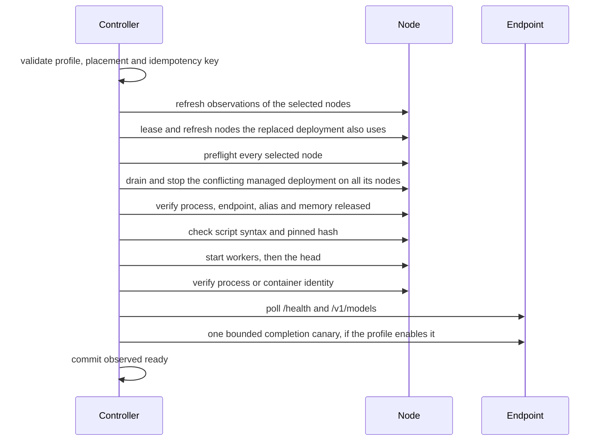
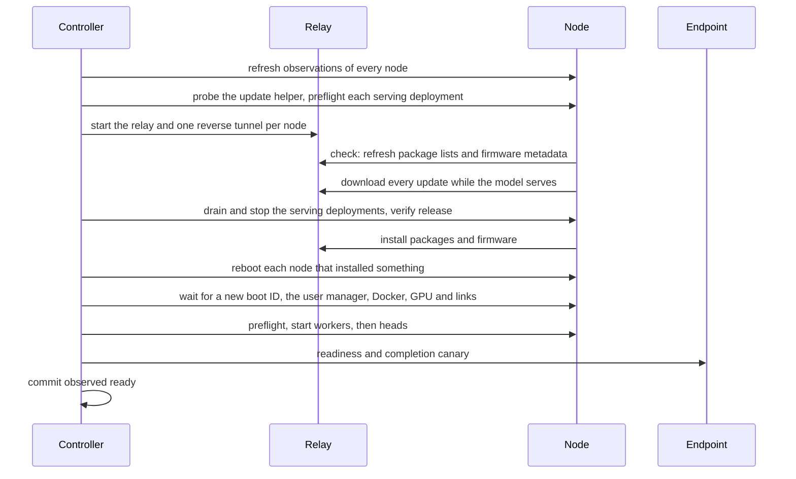

# Operations and safety algorithms

Every lifecycle mutation is a durable operation with an idempotency key,
cluster and node leases, append-only events, a phase, progress, the previous
placement, redacted evidence and a final state. The browser and API cannot
mutate a node directly; they can only enqueue operations. The exceptions are
the Updates page's check, which refreshes package lists and firmware
metadata, and the one-time [update helper](#node-helper) install. Operation
states and codes are listed in the
[state and error catalog](STATE_AND_ERROR_CATALOG.md).

| Action | Worker | Changes a model? |
| --- | --- | --- |
| `load` | lifecycle | yes: may stop the conflicting deployment on every node it uses, then starts the profile |
| `unload` | lifecycle | yes: stops one proven deployment |
| `recover` | lifecycle | yes: stops an exactly identified shared placement |
| `reconcile` | lifecycle | no |
| `update` | lifecycle | yes: stops the serving deployments, updates and reboots every node, then restores them |
| `prepare` | recipe | no: downloads images and weights only |
| `delete-recipe` | recipe | no: removes a recipe's profiles and controller-owned node files |

The lifecycle worker runs one operation at a time. `prepare` and
`delete-recipe` run on the recipe service's own worker, one at a time, so a
download can proceed while a load or unload runs.

## Load or switch

1. Validate the request; a duplicate idempotency key returns the existing
   operation.
2. Acquire the cluster lease and the node leases. Refresh observations; never
   plan from a stale UI snapshot. If a managed deployment observed on a
   selected node also uses nodes outside the selection, extend the leases to
   those nodes and refresh them too (see
   [Switching across placements](#switching-across-placements)).
3. Preflight every selected node: SSH reachability, the `systemd --user`
   manager, model files and manifest hash, the recipe revision and pinned
   image (shared vLLM), script readability, `bash -n` and the pinned SHA-256,
   and the observed endpoint and memory state.
4. Record the previous placement, including the nodes outside the selection,
   and mark a conflicting managed deployment draining.
5. Stop the conflicting deployment on every node it uses through its own named
   unit or pinned stop script, head before workers. Never use a broad process
   match.
6. Verify the old process or container is gone, the endpoint is closed, the
   alias is absent, and free memory and swap satisfy both profiles before
   starting anything. Nodes outside the new placement pass the release checks
   an unload of the replaced deployment would apply.
7. Record the replaced deployment `stopped`. Start worker roles, then the
   head, using only the pinned script. The profile's argv fragments are
   checks, not a replacement command.
8. Poll until process identity, `/health == 200` and the exact alias all pass,
   within the profile's startup timeout. A dead rank fails the load at once.
9. If the profile enables `readiness.completion_canary`, send one bounded
   completion request (see [Completion canary](#completion-canary)).
10. Persist `ready` and release the leases.
11. On failure, stop every partially started unit. Restore the previous
    placement on all of its nodes, including those outside the new placement,
    only if its readiness can be proven again; otherwise end in
    `needs-attention`.

If preflight observation proves the requested placement is already ready, the
operation commits without any remote mutation.

A lease keeper renews the leases while long SSH work runs, so a slow startup
cannot silently lose exclusivity.

### Switching across placements

A deployment cannot keep running on part of its placement, so a load replaces
every managed deployment observed on a selected node on all of the nodes that
deployment uses. For example, with a tensor-parallel deployment on spark-a and
spark-b, loading a one-node profile on spark-a stops both ranks, verifies both
nodes, starts the new model on spark-a, and leaves spark-b idle.

- The extra nodes join the operation's leases in one all-or-nothing,
  deterministic step, and the lease keeper renews them with the rest. A live
  lease of another operation on an extra node fails the load with
  `operation_locked` before anything is stopped.
- The extra nodes are refreshed before any decision. An unreachable extra node
  fails with `node_unreachable`; an unmanaged process there fails with
  `unmanaged_conflict` and is never stopped.
- An extra node owned by a different managed deployment, or no longer
  configured, fails with `partial_cluster_conflict`: the replaced deployment
  cannot be proven stopped everywhere.
- The previous placement records `extra_node_ids`. A rollback restores the
  replaced deployment on every one of its nodes, workers before the head.

The load dialog names every node that will be stopped, including nodes outside
the selection. See [ADR-0006](adr/0006-whole-deployment-switch.md).

### Completion canary

Health and an exact alias prove that a runtime serves a model, not that it can
generate. When a profile sets `readiness.completion_canary.enabled`, the load
sends one request after the readiness checks pass and before it commits:

- `POST <completion_path>` (default `/v1/chat/completions`) with the exact
  alias, the profile's prompt as one user message, its `max_tokens`, and
  `temperature: 0`, bounded by its `timeout_s`.
- It runs over SSH on the serving node (the head, or the single node) and
  reaches the endpoint the way observation does: `127.0.0.1:<port>` for a
  shared vLLM rank, the management address for an independent unit. The
  request is a fixed script; every value is shell-quoted reviewed
  configuration.
- It passes on HTTP 200 with a first choice whose `finish_reason` is `stop` or
  `length` and `usage.completion_tokens > 0`. A reasoning model may spend
  every token on reasoning and return empty content; that still passes.
- Any other outcome fails the load with `completion_canary_failed` and the
  normal rollback runs.
- Events `completion_canary_started`, `completion_canary_passed` and
  `completion_canary_failed`, and the operation `result.completion_canary`,
  record only the node, pass or fail, HTTP status, latency, completion token
  count and finish reason. Neither the prompt nor the response text is
  journaled.

Generated profiles enable it with a short prompt; reviewed profiles keep their
configured value, disabled by default. A load whose placement is already
ready, and the restore of a previous placement, do not run it.

### Shared vLLM launches

- **Per-node** (generated recipes): on each node, workers first, the controller
  renders that node's mode-`0600` environment overlay, writes its ownership
  marker, checks the pinned `start.sh`, and starts it in the unit
  `dgx-cluster-<deployment-id>.service`. Each node reports its own launcher
  outcome. See [Architecture](ARCHITECTURE.md#per-node-launch-contract).
- **Head-script** (hand-reviewed profiles): the controller renders the overlay
  and writes ownership markers on every node, then runs the reviewed launcher
  on the control node, which starts the worker before the head.

Ownership markers live in `${XDG_STATE_HOME:-$HOME/.local/state}/dgx-controller`
(directory `0700`, files `0600`) so they outlive SSH sessions. Stop removes
them; reconciliation never creates them.

## Unload

1. Refresh state and confirm the deployment still owns its unit, containers and
   endpoint.
2. Acquire leases and mark the deployment draining.
3. Stop the head (or single unit) and then the workers through their own
   identity, escalating only after a timeout.
4. Verify process exit, endpoint closure, alias disappearance, memory recovery
   and the swap bound. Model files are never touched.
5. Persist `stopped`, append evidence and release the leases.

A process, healthy endpoint or alias that cannot be tied to the deployment
blocks unload with `unmanaged_deployment`. `already_stopped` is returned only
after the same release checks pass on every node; missing ownership alone
never satisfies it.

## Update the cluster

An `update` operation installs every pending OS package and firmware update
on every configured node and restores the deployments that were serving. It
starts from the Updates page or from the [schedule](#update-schedule), and
holds the cluster lease and every node lease from its first check to its
end. While it is queued or running, another update and a recipe prepare are
refused with `update_in_progress`; while a check runs, an update is refused
with `update_check_running`. Nodes need no Internet access: every download
goes through the [update relay](#update-relay).

1. Acquire the cluster lease and every node lease.
2. Refuse with `update_blocked` while a recipe prepare or delete runs. Refresh
   every node: an unreachable node fails with `node_unreachable`, a workload
   the controller does not manage with `unmanaged_conflict`, and a managed
   deployment that is not ready on all its nodes with `deployment_not_ready`.
   The ready managed deployments are the ones to restore.
3. Probe every node's helper; any state but `ready` fails with
   `update_helper_not_ready`. Run each serving deployment's read-only
   preflight (`preflight_failed`).
4. Start the relay and the tunnels and run the helper's `check` on every node.
   With nothing pending and no reboot pending, the operation succeeds with
   `result.up_to_date: true` (event `cluster_up_to_date`) and touches no
   deployment.
5. Run the helper's `download` on every node at once and wait for all; the
   deployments keep serving.
6. Record the deployments to restore as the previous placement (phase
   `snapshotting`). Drain and stop them, serving roles before workers, and
   verify process, endpoint, alias and memory release. They stay desired
   `ready`.
7. Run the helper's `apply` on every node at once: `dpkg --configure -a`,
   `apt-get full-upgrade` keeping existing configuration files, then
   `fwupdmgr local-install` for each pending firmware cabinet.
8. Reboot every node whose install succeeded and that installed a package or
   firmware or needs a reboot. Wait until each reports a new boot ID, its
   user's `systemd --user` manager `running` or `degraded`, Docker, the GPU
   and all of its configured cluster addresses. The system-wide boot state is
   not required: on a node without a display, gdm never takes over from the
   boot splash, so `plymouth-quit-wait.service` keeps systemd `starting`
   while everything a model needs runs.
9. Restore the stopped deployments: run their preflight again, start workers
   before heads, wait for identity, health and the exact alias, run each
   enabled completion canary, and commit `ready`.

Helper runs are polled every 10 seconds. `update_progress` events carry each
node's step and `node_back_online` its new kernel and driver. Nothing is
retried:

| Failure | Deployments | Final state |
| --- | --- | --- |
| a refusal in steps 1 to 4, or a relay or tunnel failure before the stop (`relay_tunnel_failed`, `relay_failed`) | untouched | `failed` |
| a download that fails or cannot start on any node, or exceeds 4 hours | untouched | `failed`, `update_download_failed` or `update_timeout` |
| a stop that cannot be proven | not restored; nothing installed | `needs-attention` |
| an install that fails or cannot start on a node | restored; that node is not rebooted, the others are | `needs-attention`, `update_install_failed` |
| a node refuses its reboot | restored; the other nodes are rebooted | `needs-attention`, `node_reboot_refused` |
| install exceeds 2 hours, or a rebooted node is not back within 45 minutes | not restored | `needs-attention`, `update_timeout` or `node_reboot_timeout` |
| restore fails | the ranks it started are stopped and verified; desired stays `ready` | `needs-attention`, `update_restore_failed` |

When the deployments were not restored, load the previous profile once every
node is back. Quitting the controller does not stop a helper run on the
nodes; on the next start, reconciliation ends the operation `needs-attention`
with `operation_interrupted`, and stopped deployments stay desired `ready`.

### Node helper

All root work on a node goes through
`/usr/local/sbin/dgx-spark-controller-update`, installed from
`controller/updates/templates/dgx-spark-controller-update.sh`:

| Subcommand | Effect |
| --- | --- |
| `check` | refresh package lists and LVFS metadata through the relay; report pending package and firmware counts |
| `download` | start a run that fetches every pending package and firmware cabinet without installing |
| `apply` | start a run that installs them |
| `status` | the last run's state, step and boot ID, and the log tail after a failure |
| `reboot` | reboot 5 seconds later through the `dgx-spark-controller-reboot` timer |

`download` and `apply` run in the transient system unit
`dgx-spark-controller-update.service`, so they outlive the SSH session;
`check` and `reboot` refuse while it is active, and a second `download` or
`apply` reports the running one. State is kept in
`/var/lib/dgx-spark-controller-update/` and the run log in
`/var/log/dgx-spark-controller-update.log`.

The Updates page shows each node's helper as `ready`, `missing`, `outdated`
(hash or ownership differs), `no-sudo` (sudoers rule missing) or
`unreachable`. **Install helper** installs it on every node that is not
`ready`, using the node user's sudo password once (see
[Security](SECURITY.md#system-updates)). To remove it, run
`sudo /usr/local/sbin/dgx-spark-controller-update uninstall` on the node; it
deletes the helper, its sudoers rule and its state, and keeps the log.

### Update relay

For every check and update the controller serves a loopback HTTP relay and
opens one `ssh -R` tunnel per node, so each node reaches the relay at
`127.0.0.1:18877`. A tunnel lives only as long as the controller process.
Before any helper call the controller reads the relay session's random token
through each node's port, so another program listening on that port is never
accepted (`relay_tunnel_failed`). The helper points apt and fwupd at the
relay through a private copy of the node's apt sources rewritten to
`http://`, with insecure repositories denied. Sources with credentials in
`/etc/apt/auth.conf*`, such as Ubuntu Pro ESM, and sources marked
`trusted=yes`, `allow-insecure=yes` or `allow-weak=yes` (or the deb822
equivalents) stay unchanged; `https://` ones pass through a `CONNECT`
tunnel, online only.

The source is chosen on the Updates page:

- **Internet** (`online`): the relay fetches each file with the scheme the
  nodes' sources use and keeps a copy in `<data>/update-cache/<host>/<path>`.
  Packages and firmware cabinets that came over `https` are served from that
  cache when present; everything else is fetched fresh, so a bad copy from a
  plain-`http` mirror never sticks.
- **Directory** (`directory`): the relay serves `<directory>/<host>/<path>`
  and opens no network connection. A cache copied from an online controller
  works as is, and so does an apt-mirror tree (its `mirror/` directory).
  Without the LVFS metadata (`cdn.fwupd.org/downloads/firmware.xml.zst` and
  `.jcat`) firmware is skipped; metadata that fwupd rejects fails the run. Credentialed and unsigned sources are left
  out, and any other missing file fails the check or download.

The relay serves only hosts the nodes' apt sources name, plus
`cdn.fwupd.org` and `fwupd.org`. apt and fwupd verify every index, package
and firmware file on the node, so neither the relay nor the directory is
trusted.

### Update schedule

The schedule is a set of weekdays and one local time of the controller host.
The update service looks every 30 seconds for a due slot and submits one
`update` operation per slot (idempotency key
`scheduled-update-<yyyymmddTHHMM>Z` in UTC, requester `schedule`); while a
check runs it waits for the next look. A slot starts only while the
controller runs within one hour after it, and never when the settings were
saved after it, so the controller host must be running and awake then; a
missed slot is skipped. While an update runs, the controller holds a macOS
idle-sleep assertion (`caffeinate -i`) so the relay and tunnels stay up. A refused submission appears as `schedule_error` on
the Updates page. A scheduled update stops and restores the serving model
like a manual one.

## Prepare

A recipe prepare downloads everything a generated profile needs, without
touching any model process. Details are in [Recipes](RECIPES.md#3-prepare).

1. Validate the draft against the current nodes: port inside every node's
   range, same first model root, same home directory, and lingering enabled
   for the node user (`linger_required` otherwise). Nothing on a node has
   changed yet.
2. Install `prepare.sh`, its data file and the expected weight list in the
   recipe directory on every node, verifying each file's SHA-256.
3. Start `prepare.sh` in `dgx-prepare-<id>.service` on every node.
4. Poll every node, journal progress, and fail fast when a node reports
   `failed` or stops reporting.
5. Require all nodes to report the same image ID, vLLM version and weight
   manifest hash.
6. Install `start.sh`, `stop.sh` and `recipe.env` on every node, write the
   generated profile, and mark the draft `prepared`.

Prepare takes no lease. On failure or cancellation the controller stops the
prepare units and download containers it started, then removes that prepare's
recipe directory on every node; downloaded weights and the image remain and
are reused by the next prepare. Closing the controller does not stop a
prepare; the next start reattaches to it (see
[Recipes](RECIPES.md#controller-restarts)).

## Delete a recipe

A `delete-recipe` operation removes a recipe's generated profiles and their
recipe directories, then the draft; with `remove_artifacts` also the weights,
image and cache volume that nothing else on a node uses. Details and limits
are in [Recipes](RECIPES.md#5-delete) and [Security](SECURITY.md#deleting-recipes).

1. Refuse (`409 profile_in_use`) while a deployment of one of the profiles is
   not stopped or a lifecycle operation for one of them is queued or running.
2. Acquire the node leases of every affected node (not the cluster lease) and
   check again.
3. Per profile and node, remove the recipe directory with a fixed script that
   refuses symlinks, a running prepare unit and the profile's containers.
4. Delete a profile file only after all its directories are gone, and reload
   the profile registry.
5. Optionally remove unreferenced weights and images, and the cache volume
   on a node whose last generated profile was deleted.
6. Delete the draft, release the leases, and report every artifact outcome.

## Reconciliation

On startup, and when requested, reconciliation queries every configured node
and compares process or container identity, endpoint health, alias and profile
revision with the journal:

- A matching managed deployment is adopted as observed state.
- A process that does not match is reported as `unmanaged` and never stopped.
- A known managed replacement proves an older placement stopped and records
  its desired state as stopped, which also settles journals written before
  switches did so. A deployment that stopped without a replacement keeps its
  desired state, so the drift stays visible.
- Lifecycle operations left `running` by a restart succeed only if their
  outcome is proven; otherwise they end `needs-attention` with
  `operation_interrupted`. Queued lifecycle operations are cancelled.
- Recipe operations (`prepare`, `delete-recipe`) are skipped entirely; the
  recipe service reattaches to a running prepare and settles everything else
  on startup.

Node actions in the UI use only the freshly observed deployment ID; they never
select a historical deployment because it used the same node.

## Cancellation and rollback

A lifecycle operation can be cancelled only while it is still `queued`. Once
remote work has started, the operation runs to a verified end, including
bounded cleanup. A running prepare can be cancelled at any time, and a queued
recipe delete until it starts. Rollback is
best effort but bounded: a failed restoration is explicit and never hidden
behind a successful result.

## Recover baseline

Recovery is a deliberate mutation for a shared vLLM placement whose normal
ownership marker may be missing after an interruption. It accepts only a
registered profile ID, proves the profile's pinned image and argv identity on
every present rank, runs the pinned stop script (per node for per-node
profiles, head first), then verifies process, endpoint and alias absence,
memory recovery and the swap bound. An unknown identity fails closed and is
never stopped.

## Redaction

Events may contain node and profile IDs, phase, exit status, bounded output
and hashes. Key contents, tokens, secret-looking environment values and
command fragments are redacted before they are stored or shown. Commands are
represented as fixed scripts or argv, never as browser-supplied text.
